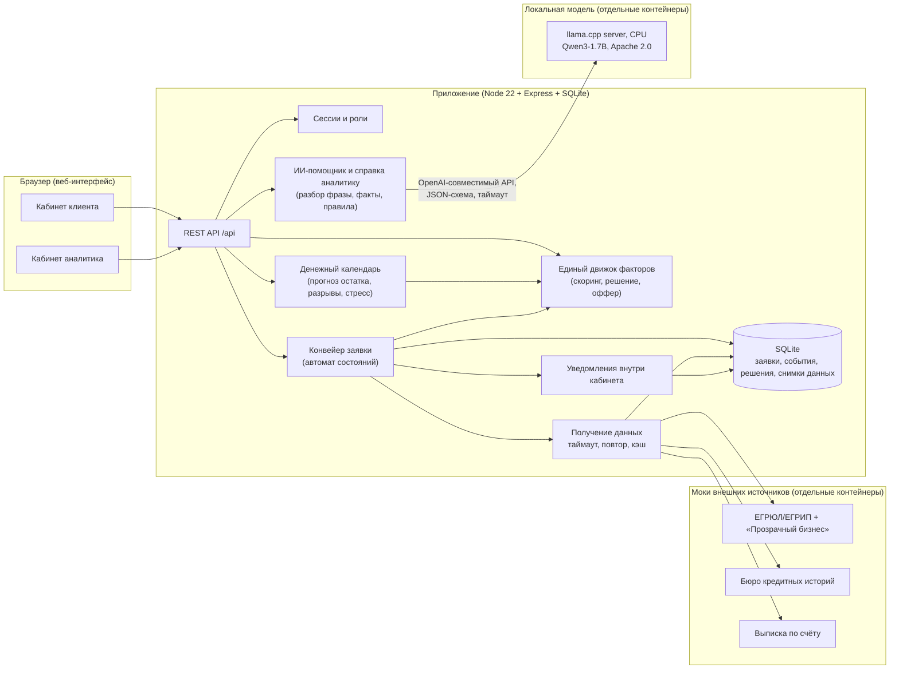

# Архитектура

## Схема

## Модули и их ответственность

| Модуль | Файлы | Что делает |
|---|---|---|
| Движок | `app/src/engine/` | Чистые функции без доступа к БД и сети. `scoring.js` оценивает риск и считает метрики, `decision.js` применяет политику банка и ищет альтернативы, `offer.js` готовит предодобрение, пересчёт и «что изменилось» |
| Автомат заявки | `app/src/services/applications.js`, `statuses.js` | Таблица переходов — единственный источник правды; каждый переход пишется в журнал |
| Данные | `services/enrichment.js`, `context.js` | Запросы к источникам с таймаутом и повтором; последний удачный ответ сохраняется и используется при сбое (с признаком `degraded`) |
| Денежный календарь | `engine/cashflow.js` | Прогноз остатка на 12 месяцев по выписке: постоянные расходы, доля поставщиков, налоги и ежегодные события повторяются, разовые — нет. Разрывы, подбор овердрафта под разрыв, наложение кредита (овердрафт — возобновляемый лимит), стресс «выручка −20 %» |
| Автопилот денег | `engine/cashflow.js` (`simulateAutopilot`, `suggestAutopilot`), таблица `autopilot` | Копилка: доля поступлений из вывода собственнику до разрыва; защита: резервный лимит овердрафта, одобряется движком решений; подбор минимальной доли копилки и лимита на остаток |
| Лента | `services/feed.js` | Строится из прогноза клиента (разрыв, ближайшие крупные списания, «всё спокойно»), плюс готовность к кредиту, подсказки по отрасли и примеры мер поддержки. Клиенту со стоп-фактором кредит не предлагается |
| ИИ-помощник | `services/llm.js`, `services/intent.js` | Клиент модели по OpenAI-совместимому API (llama.cpp, Ollama, vLLM): ответ строго по JSON-схеме, таймаут, прогрев. Разбор фразы клиента: модель выбирает цель и числа только из текста, при любой ошибке — правила |
| Справка аналитику | `services/brief.js` | Факты с источниками из данных заявки и календаря, вывод, «на что смотреть» по серьёзности и вопросы клиенту — по правилам |
| Доступ | `auth.js` | scrypt-хэши, подписанный HttpOnly-токен, роли, защита от перебора, проверка Origin |
| API | `routes/api.js` | Тонкий слой: разбор запроса, вызов сервиса, формат ответа |
| Интерфейс | `app/public/` | SPA на чистом JS без сборки; текст вставляется как text node |
| Моки | `mocks/` | Три HTTP-сервиса без зависимостей; `POST /__control` имитирует сбой и задержку |

## Почему так

- **Один движок на всё.** Предодобренный лимит, редактор условий, решение по заявке и контр-оферта вызывают одни и те же функции. Поэтому цифры в разных местах не расходятся: клиент не увидит «предодобрено 3 млн», а затем отказ по тем же данным.
- **Скоринг и решение разделены.** Скоринг отвечает на вопрос «насколько рискованна заявка», политика — «что с этим делать»: автоматически одобрить, отправить человеку, предложить другие условия, отказать. Исход не двоичный.
- **Решение воспроизводимо.** Для каждой заявки хранятся снимки ответов источников, версия движка, факторы с баллами и тот, кто решал. Расчёт можно повторить и разобрать.
- **Сбои источников — штатная ситуация.** Если источник недоступен, берётся сохранённая копия, а решение уходит сотруднику банка. Если копии нет — заявка не теряется, аналитик может повторить проверку.
- **Конвейер в процессе приложения.** Для прототипа достаточно: этапы идут по таблице переходов с паузами, при старте незавершённые заявки подхватываются. Для продакшна конвейер выносится в очередь (см. «Развитие»).

## Развёртывание

`docker compose up --build` поднимает приложение, три мока и локальную модель: `llm` (сервер llama.cpp, образ ~310 МБ, закреплён по digest) и одноразовый `llm-model`, который скачивает Qwen3-1.7B (1,8 ГБ) по закреплённой ревизии и сверяет SHA-256. Данные приложения лежат в томе `cabinet-data`, модель — в `llm-models`. Приложение не зависит от модели жёстко: стартует сразу, а пока модель загружается, помощник работает по правилам. `LLM_ENABLED=0` выключает ИИ.

Переменные окружения описаны в `.env.example`.

## Безопасность прототипа

- Пароли — scrypt с солью; токен — HMAC-SHA256, HttpOnly, SameSite=Lax; для запросов с Origin проверяется совпадение хоста.
- Чужая заявка отвечает 404, а не 403: номера нельзя перебирать.
- Заголовки: CSP без inline-скриптов и стилей, `X-Frame-Options: DENY`, `nosniff`.
- Вход ограничен: 8 неудач за 10 минут на пару «логин + IP».
- Клиенту не отдаются баллы, веса и пороги; тест `клиент не видит баллов и порогов` проверяет это на реальном ответе.
- Допущение: подключение компании по ИНН не проверяет полномочия пользователя. В реальном продукте нужна подпись или проверка через доверенный канал.
- ИИ: модель работает внутри контура (Docker), текст клиента наружу не уходит. Модель не принимает решений и не может «придумать» сумму: числа принимаются, только если они есть в тексте.

## Развитие

1. Очередь задач (например, на PostgreSQL или брокере) вместо конвейера в процессе, чтобы обработку можно было масштабировать.
2. PostgreSQL вместо SQLite, миграции.
3. Реальные адаптеры источников вместо моков: интерфейс `loadSource` не меняется.
4. Версионирование политики и модели, A/B-сравнение решений на исторических заявках.
5. Мониторинг: доля ручной проверки, время решения, причины отказов, доля контр-оферт, принятых клиентами.
