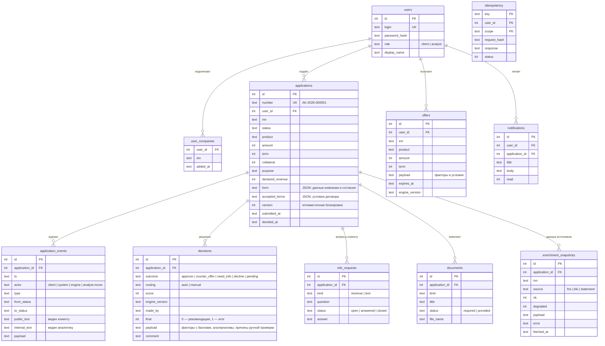

# Модель данных

SQLite, схема создаётся при старте (`app/src/db.js`, константа `SCHEMA`). Суммы хранятся целыми рублями, время — ISO-8601 UTC.

## Автопилот

| Таблица `autopilot` | Тип | Смысл |
|---|---|---|
| `user_id`, `inn` | ключ | Настройки клиента для компании |
| `reserve_share` | REAL | Доля поступлений в копилку (0–0,2, не больше доли вывода собственнику) |
| `protection_limit` | INTEGER | Лимит защиты от разрыва, ₽ (0 — выключена); включается только после одобрения движком |
| `protection_rate` | REAL | Ставка по лимиту на момент одобрения |
| `updated_at` | TEXT | Когда изменены настройки |

## Принципы

- **Журнал событий не редактируется.** `application_events` только дописывается; у каждой записи есть автор. Клиент видит записи с `public_text`, аналитик — все.
- **Рекомендация и решение разделены.** При ручной проверке движок пишет `decisions` с `final = 0`, аналитик — запись с `final = 1`. Клиент видит только итоговое.
- **Снимки данных.** Решение пересчитывается по сохранённым ответам источников, а не по тому, что они вернут сегодня.
- **Идемпотентность.** Ключ + пользователь + область + хэш тела.
