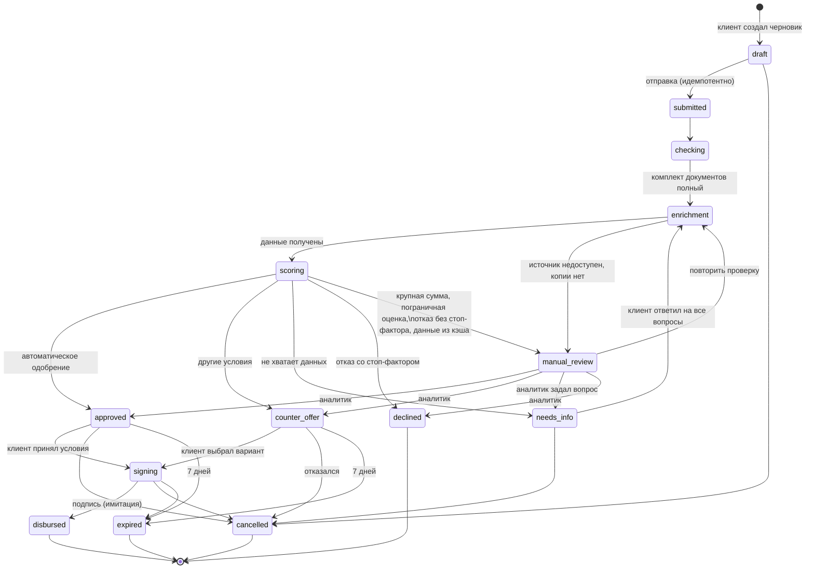

# Диаграмма состояний заявки

Источник правды — таблица `TRANSITIONS` в `app/src/services/statuses.js`. Недопустимый переход возвращает 409 `invalid_transition`.

## Что видит клиент на каждом статусе

| Статус | Заголовок | Что дальше |
|---|---|---|
| draft | Черновик | Заполнить, приложить документы, отправить |
| submitted, checking, enrichment, scoring | Заявка принята, Проверяем документы, Собираем данные, Оцениваем заявку | Ничего не делать, статус обновляется сам |
| manual_review | Проверяет специалист банка | Ждать, при вопросах банк спросит в карточке |
| needs_info | Нужна информация | Ответить на вопрос; остальные данные сохранены |
| counter_offer | Есть другое предложение | Выбрать вариант или отказаться |
| approved | Одобрено | Принять условия |
| declined | Отказ | Прочитать причины и план, пересчитать условия |
| signing | Подпишите договор | Подтвердить и подписать |
| disbursed | Деньги на счёте | — |
| cancelled, expired | Отменена, Срок предложения истёк | Подать новую заявку |

Тексты хранятся в `STATUS_VIEW` и совпадают с тем, что показывает интерфейс.
